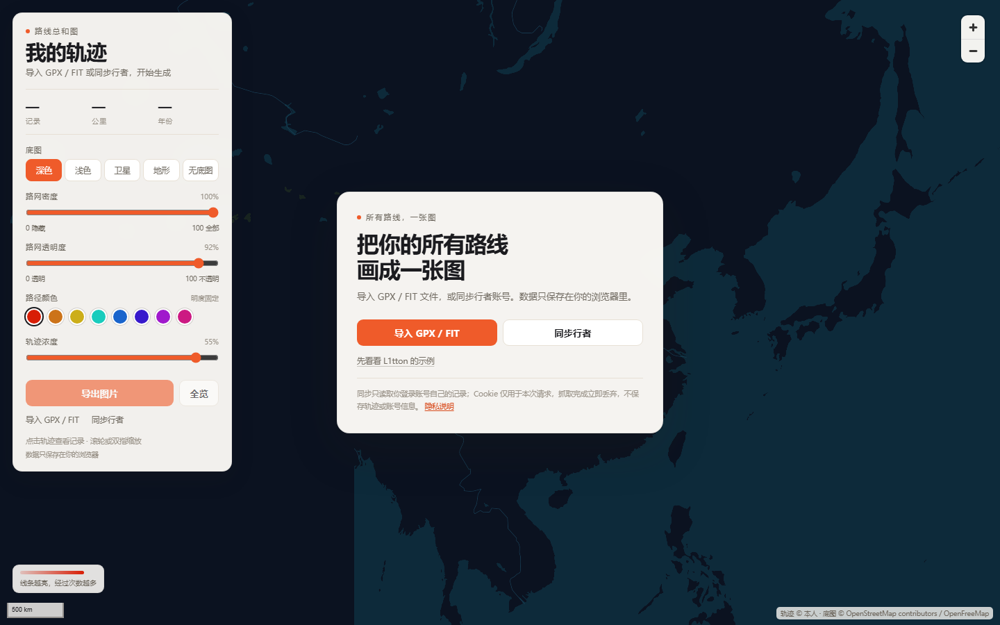

# 路线总和图

把 GPX / FIT 文件或行者账号里的全部运动记录，画成一张可缩放、可导出的路线总和图。

这是一个给所有人使用的公开站点：访客不需要注册，导入自己的 GPX / FIT 或同步自己的行者账号即可生成；数据只保存在访客自己的浏览器里。站点本身没有账号系统，也不在服务器上保存轨迹。

## 功能

- **名称可编辑**：左上角的名字点击即可修改，自动保存在浏览器；导出的图片使用这个名字
- **面板可拖动 / 可隐藏**：拖住面板顶部可放到页面任意位置，位置保存在浏览器；点右上角 `×` 收成左上角的小按钮，点小按钮恢复
- **GPX / FIT 导入**：同一个导入按钮，支持多选、拖拽、整个文件夹；GPX 解析 trkseg，FIT 解析 record/session，自动计算里程、日期和用时
- **行者同步（仅同步自己）**：粘贴一次自己的行者登录 Cookie；默认只同步最近 1 年，自动跳过“合并”记录，服务端只读取该账号数据，抓完立即丢弃 Cookie
- **示例数据**：可选的 L1tton 演示数据（已排除合并记录）；因含个人轨迹，不随仓库提供
- 全部轨迹叠加，低缩放自动收细线条，密集区域不糊成一块；数据少时自动加粗
- 默认使用深色底图；浅色和深色是同一套普通矢量底图，只切换陆地、水系、道路的颜色，不带地形和注记
- 浅色、深色、卫星、地形、无底图 5 种底图；卫星使用 GCJ-02 纠偏。道路统一颜色、只按等级改粗细，并按缩放分级出现
- 浅色和深色提供「路网密度」和「路网透明度」两个滑杆：密度控制显示哪些道路等级，透明度控制整层路网浓淡；两者都可以调到 0，完全隐藏路网
- 地形是天地图地形压暗 + 道路，默认不显示地名，可在底图下勾选“显示地名”；底图只使用符合中国地图标准的来源，不再提供境外底图
- 路径颜色色板：8 种固定明度的颜色，可随时切换并持久化；不提供亮度调节，避免路径过亮或过暗；整体浓淡仍用“轨迹浓度”控制
- 滚轮/双指缩放、比例尺、一键全览、点击轨迹查看详情
- 导出 PNG：可选全部轨迹或当前视图、6 种画面比例、标准/高清/超清/海报/超大/自定义长边、1–4× 底图超采样和分块拼合；可选标题栏；文件名按 `名字-日期-四位编号` 自动递增

## 预览

空状态与界面（不含个人轨迹）：



> 包含个人轨迹的预览图不随仓库提供，避免公开位置信息；本地运行后可导入自己的 GPX / FIT 查看完整效果。

## 快速开始

要求 Node.js **20.3+**（使用了 `AbortSignal.any`）。运行不需要安装 npm 依赖；FIT 解析器已经打包在 `web/assets/vendor/` 里。

```powershell
npm start
```

打开 <http://127.0.0.1:5173/>。

开发时也可以直接 `node serve.mjs`。`PORT` 默认 5173，`HOST` 默认 127.0.0.1。

只有需要重新构建 FIT 解析器时才安装开发依赖：

```powershell
npm install
npm run build:fit
```

### 配置天地图地形

地形使用天地图官方 WMTS 图层，需要一个服务端 key；浅色/深色使用 OpenFreeMap，不需要 key。

1. 在 [天地图控制台](https://console.tianditu.gov.cn/) 注册，创建一个 **服务端 key**
2. 把本站服务器的公网 IP 加入 IP 白名单（部署在反向代理/云函数后时，用实际出口 IP）
3. 填写 key，两种方式任选：

```powershell
Copy-Item .env.example .env
notepad .env
node serve.mjs
```

或在当前终端设置环境变量：

```powershell
$env:TIANDITU_KEY="你的服务端 key"
node serve.mjs
```

`.env` 已被 gitignore，不会提交；真实环境变量优先于 `.env`。

Docker：

```bash
docker run --rm -p 5173:5173 -e TIANDITU_KEY="你的服务端 key" route-atlas
```

4. 刷新页面，底图栏会出现「地形」；未配置 key 时只隐藏地形

图层说明：

- 浅色 / 深色：OpenFreeMap 普通矢量底图（陆地、水系、道路），不带地形，也没有注记；两套只是颜色不同，面板都提供“路网密度”和“路网透明度”滑杆，0% 都可以完全隐藏路网
- 地形：`ter_w` 地形晕渲压暗 + `cta_w` 地形注记；叠加 OpenStreetMap 道路
- 道路统一使用一种颜色，只按道路等级改变粗细；按缩放分级出现：高速/国道 → 主干道 → 次干道 → 支路，避免小比例尺下路网过密
- 地形默认不加载注记，需要地名时在底图下勾选“显示地名”；浅色/深色本身不显示地名
- 坐标系：CGCS2000，与 WGS-84 基本一致，不做 GCJ 纠偏
- 版权：天地图；公开传播前按属地要求确认审图号/备案
- 瓦片通过 `/api/tdt/...` 同源代理，浏览器不直接请求天地图，避免 CORS 和 key 暴露；导出也不会跨域污染

注意：浏览器端 key 通常绑定 Referer，不适合服务端代理；这里请用服务端 key + IP 白名单。未配置 key 时地形按钮隐藏，仍可使用浅色、深色、卫星、无底图。

## 使用

### 修改名字

左上角的名字是一个输入框，点击即可修改，回车或失焦保存。名字和行者账号没有强绑定。

- 行者同步成功后，名字会更新为行者账号名（这是为了让你一眼知道当前数据来自哪个账号）
- 更新后仍然可以随时手动改成任何名字
- GPX / FIT 导入不会改名字，默认是“我的轨迹”
- 清除数据不会删除你手动设置的名字

### 导入 GPX / FIT

1. 点击“导入 GPX / FIT”，或把 `.gpx` / `.fit` 文件直接拖进页面
2. 支持一次选多个文件，GPX 和 FIT 可以混选
3. GPX 按 trkseg 拆分；FIT 读取 `record` 的 GPS 点和 `session` 的起止时间、总距离、总用时
4. 已有的文件数据会追加；如果当前显示的是示例数据，导入会替换示例
5. 数据保存在浏览器 IndexedDB，刷新不丢；点“清空”删除

单个文件上限 30MB，一次最多 800 个文件；单条轨迹最多保留约 1200 个点，多段 GPX 会拆成多条记录。

### 同步行者

> 行者官方 OAuth 接口只返回运动列表、距离、时间等元数据，**不返回轨迹点**。所以自动同步使用的是行者网页版的登录 Cookie，而不是 OAuth。

**先了解风险**

- Cookie 等同于行者登录凭证，只在这个你信任的站点使用，不要发给别人或截图
- 同步只读取你账号自己的运动列表和 GPX，不会修改、删除或上传任何行者数据
- 行者可能因请求较多临时限流。请从小范围开始；如果失败，等 15–30 分钟再试，不要连续重试
- 如果担心风险，直接用 GPX / FIT 导入，不需要 Cookie

**同步范围**

| 选项 | 请求月份数 | 说明 |
| --- | --- | --- |
| 最近 1 年（默认） | 12 | 推荐，最不容易触发行者限流 |
| 最近 3 年 | 36 | 记录较多的账号 |
| 全部历史 | 2012 至今 | 最慢，也最容易被限流 |

**复制 Cookie 的详细步骤**

1. 在浏览器登录 [行者网页版](https://www.imxingzhe.com/login)，确认能看到自己的运动记录
2. 按 `F12`（或 `Ctrl+Shift+I`）打开开发者工具，切到 `Network` 面板
3. 按 `Ctrl+R` 刷新页面，在过滤框输入 `www.imxingzhe.com`
4. 点任意一条域名是 `www.imxingzhe.com` 的请求，例如 `get_user_info` 或最上面的文档请求
5. 在右侧 `Headers` → `Request Headers` 找到 `Cookie`，复制冒号后的完整内容
6. 如果看不到 Cookie：右键该请求 → `Copy` → `Copy as cURL`，粘贴到记事本，复制 `Cookie:` 后面那一整段
7. 确认内容里包含 `sessionid=`，再粘贴到站点的同步弹窗
8. 选择同步范围，勾选风险确认，点击“开始同步”；同步过程中保持页面打开

**安全与限制**

- Cookie 只随这一次同步请求发送到本站服务器，存在内存里，请求结束立即丢弃；不写数据库、不写日志
- 服务端只用它读取该账号自己的 `user_id`，不接受任何“指定用户”的参数，无法拿它读别人的数据
- 建议只在 HTTPS 下使用；如果你不放心，可以只用 GPX / FIT 导入
- 标题里带“合并”的记录会自动跳过。行者会把多次记录合并成一条，但原始分段记录也会出现在列表里；保留合并记录会让轨迹重复
- 遇到行者 `429` 限流会立即停止，不会重试；请等待 15–30 分钟后再试
- 同步有频率限制：同一 IP 5 分钟内 1 次，全站最多 3 个并发同步
- 单次最多同步 1500 条轨迹，超出会截断并在 manifest 里标记
- 月份请求和 GPX 请求都加入了较大的间隔与随机抖动，避免短时间大量请求

### 路径颜色

- 面板中的“路径颜色”提供 8 个色板：红、橙、金、青、蓝、靛、紫、品红
- 这些颜色的明度固定在 45% 左右，**不提供亮度调节**；这样路径不会因为调得太亮而在底图上消失，也不会因为太暗而看不见
- 想改变视觉浓淡时，使用“轨迹浓度”滑杆（控制线条透明度），而不是调色板
- 选择会保存在 localStorage，刷新后保留；导出 PNG、图例渐变和地图线条都会使用当前颜色

### 导出图片

- **范围**：全部轨迹（当前筛选）或当前视图
- **画面比例**：自动、1:1、4:3、3:2、16:9、9:16；自动在“全部轨迹”下按轨迹范围计算，在“当前视图”下按窗口比例计算
- **清晰度**：按钮标准 3000 / 高清 4800 / 超清 7200 / 海报 9600 / 超大 16000，默认高清 4800；选择“自定义”时只输入长边，另一边按比例计算；超过 9600px 会提示文件体积和导出时间增加；超大尺寸会限制在约 1.2 亿像素内
- **底图缩放**：1×、1.5×、2×、2.5×、3×、3.5×、4× 超采样；只提高底图采样精度，不改变最终像素尺寸
- **轨迹线宽**：可开关“轨迹线宽随超采样调整”；开启时保持最终视觉线宽，关闭时超采样后线条更细
- **分块拼合**：大图按约 2048px 分块渲染后拼合，避免超过单张 WebGL 画布上限；高倍超采样会自动缩小每块尺寸
- **尺寸**：先按选择的比例和长边计算最终画布，再扣除标题/页脚，渲染隐藏地图；因此最终图片比例就是所选比例（包含标题栏时也一样）
- 标题栏、页脚和字号按最终画面高度等比缩放，竖构图或提高分辨率时比例保持一致
- 可选是否包含顶部标题与统计；页脚始终保留底图与轨迹来源
- 文件名规则：`名字-YYYYMMDD-0001.png`
  - `名字` 是左上角当前名称，非法文件名字符会替换为 `-`
  - `YYYYMMDD` 是导出当天日期（浏览器本地时区）
  - `0001` 是当天递增的四位编号，保存在 localStorage；同一天多次导出会得到 `0002`、`0003`……
  - 超过 9999 后从 0001 重新开始
- 16000px 或 4× 超采样属于大图导出，手机上可能因内存不足失败；优先在电脑上导出

## 数据与隐私

- GPX / FIT 和同步结果只存在浏览器 IndexedDB；名称存在 localStorage
- 服务器不保存访客轨迹、Cookie 或账号信息
- 服务器日志只有时间、IP、耗时、轨迹数量，用于限流和排查
- 底图瓦片由天地图 / 高德影像提供；浅色/深色底图与道路矢量由 OpenFreeMap 提供，会收到你的 IP；行者接口由服务器访问
- L1tton 示例数据是公开演示数据，但因包含个人轨迹，不随 GitHub 仓库提供；本地可用 `npm run fetch` 生成
- 详细说明见站内 [`/privacy.html`](web/privacy.html)

## 部署到公网

完整教程（阿里云 `120.26.170.230` + 域名 `penfight.fun`）：[DEPLOY.md](DEPLOY.md)

同步功能需要 Node 进程；GPX / FIT 导入本身是纯前端，但页面由同一个 Node 服务提供。

### 直接运行

```powershell
$env:NODE_ENV="production"
$env:HOST="0.0.0.0"
$env:PORT="5173"
$env:TRUST_PROXY="1"
$env:ALLOWED_ORIGIN="https://your-domain.example"
node serve.mjs
```

建议放在 Caddy / Nginx / 云平台 HTTPS 反向代理后面，强制 HTTPS；Cookie 同步不应该在 HTTP 下使用。

环境变量：

| 变量 | 默认 | 说明 |
| --- | --- | --- |
| `HOST` | `127.0.0.1` | 容器里用 `0.0.0.0` |
| `PORT` | `5173` | 监听端口 |
| `NODE_ENV` | — | 设为 `production` 时发送 HSTS |
| `TRUST_PROXY` | — | 设为 `1` 时信任 `X-Forwarded-For/Host` |
| `ALLOWED_ORIGIN` | 同源 | 反向代理改写了 Host 时指定公网 Origin |
| `MAX_SYNC_TRACKS` | `1500` | 单次同步轨迹上限 |
| `GLOBAL_SYNC_LIMIT` | `3` | 全站并发同步上限 |
| `TIANDITU_KEY` | — | 天地图服务端 key；配置后启用地形 |

### Docker

```bash
docker build -t route-atlas .
docker run --rm -p 5173:5173 route-atlas
```

### 反向代理要点

- 允许长连接和较长读超时（同步可能需要 1–3 分钟）
- 关闭对 `/api/sync` 的响应缓冲，或保留 `X-Accel-Buffering: no`
- 开启 gzip/br 压缩对静态资源有效；同步流本身不压缩
- 配置 HTTPS；不要在公开站点上使用裸 HTTP 收集 Cookie

### 去掉示例数据

示例是 `web/data/` 里的 L1tton 记录。如果不想在公开站点展示，删除 `web/data/manifest.json` 和 `web/data/tracks-*.json`，或移除首页的“先看看 L1tton 的示例”按钮。

## 目录结构

```
route-atlas/
  serve.mjs                静态服务 + POST /api/sync
  scripts/
    lib/xingzhe-sync.mjs   行者同步核心（仅服务端）
    lib/gpx.mjs            Node GPX 解析
    lib/geo.mjs            距离、简化、坐标转换
    login.mjs              本地登录助手（只用于生成示例/站长自用）
    fetch.mjs              本地抓取脚本（只用于生成示例/站长自用）
    fit-entry.js           FIT 浏览器 bundle 的入口
    test.mjs               单元测试
  web/
    index.html
    privacy.html
    assets/app.js          地图、导入、同步 UI、导出
    assets/gpx.js          浏览器 GPX 解析
    assets/fit.js          浏览器 FIT 解析（懒加载）
    assets/geo.js          距离、简化、GCJ-02
    assets/store.js        IndexedDB
    assets/styles.css
    assets/vendor/         MapLibre GL JS 4.7.1、fit-file-parser
    data/                  示例数据（可选，不随仓库提供）
  preview/                 截图（含轨迹，公开部署前可删除）
```

## 本地示例数据（可选）

`npm run login` / `npm run fetch` 是站长本地工具，用来抓取自己的行者数据生成 `web/data/` 示例；公开访客的同步走 `/api/sync`，不会使用这两个脚本。

```powershell
npm run login   # 打开浏览器登录一次
npm run fetch   # 抓取到 web/data/
```

## 测试

```powershell
npm test
```

覆盖 GPX 解析、距离计算、Douglas–Peucker 简化、WGS-84 ↔ GCJ-02 往返误差，以及 FIT 解析器 bundle 是否可加载。FIT 实际文件解析也已在浏览器里用行者导出的真实 FIT 文件验证。

## 常见问题

**同步提示“同步服务未部署”**  
站点只部署了静态文件。需要运行 `node serve.mjs` 或容器，`/api/sync` 才存在。

**同步提示 Cookie 失效**  
重新登录行者，按步骤重新复制 Cookie。

**同步提示行者限流 / 429**  
立即停止同步，等待 15–30 分钟后再试；期间不要连续重试，也不要刷新行者页面太频繁。也可以改用 GPX / FIT 导入。

**同步后记录数比行者里少**  
标题带“合并”的记录会被自动跳过，避免和原始分段记录重复；另外，行者偶尔返回 502 的 GPX 会被跳过。

**页面刷新后数据没了**  
检查浏览器是否禁用了 IndexedDB（隐私模式可能限制）；导入/同步成功后会写入本地。

**导入后名字还是“我的轨迹”**  
GPX / FIT 导入不改名字；直接点左上角改名即可。行者同步会改成账号名。

**FIT 导入失败**  
确认文件是设备导出的 FIT 活动文件（不是路书/课程文件），并且包含 GPS 记录；部分加密或损坏的文件无法解析，可以改用 GPX。

**导出很慢**  
全部轨迹导出会按所选分辨率分块创建隐藏地图并加载瓦片，记录多或开启高倍超采样时需要十几秒到更久。

**地图导出失败/跨域**  
切换到浅色、深色、卫星或“无底图”后重试；这些底图都配置了 CORS。

## 致谢与许可

本项目源代码采用 **MIT License**，Copyright © 2026 L1tton。完整许可见 [LICENSE](LICENSE)。

第三方组件与地图数据许可见 [THIRD_PARTY_NOTICES.md](THIRD_PARTY_NOTICES.md)。

- 地图渲染：[MapLibre GL JS](https://maplibre.org/) 4.7.1，BSD-3-Clause，许可证见 `web/assets/vendor/LICENSE.txt`
- FIT 解析：[fit-file-parser](https://github.com/jimmykane/fit-parser) 6.2.2，MIT，许可证见 `web/assets/vendor/fit-parser.LICENSE.txt`
- 底图：浅色/深色与道路 © OpenStreetMap contributors / OpenFreeMap；卫星影像 © 高德地图；地形 © 天地图
- 轨迹数据：© 各自作者；行者数据 © 行者 imxingzhe.com
